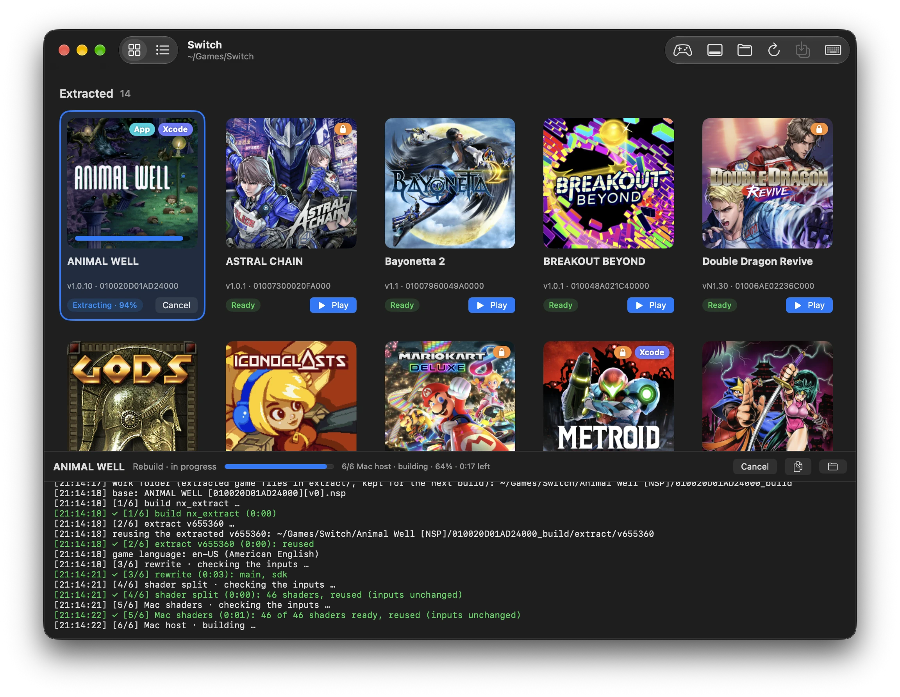
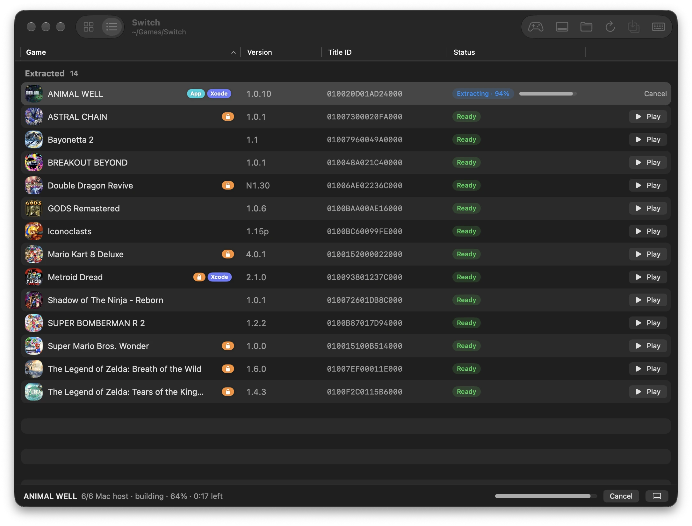
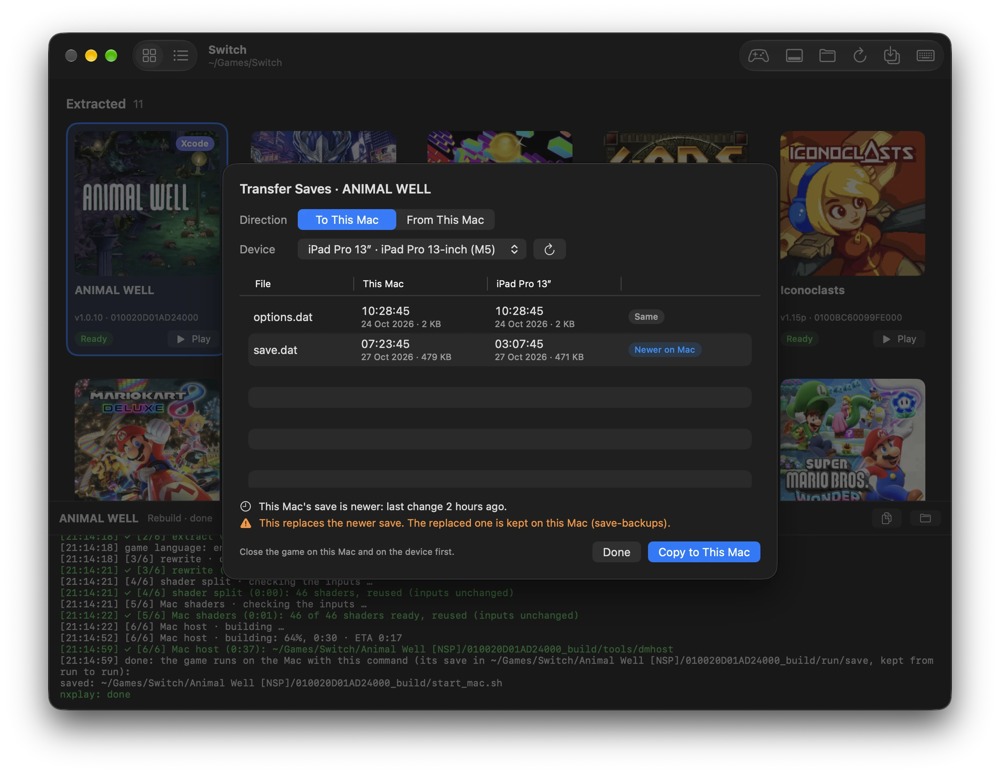
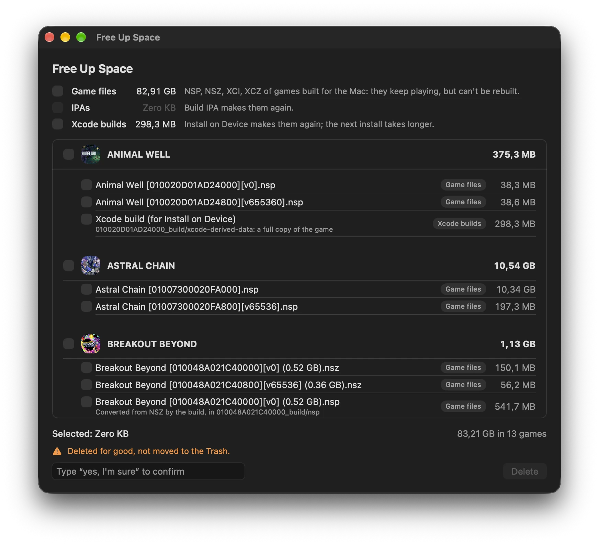
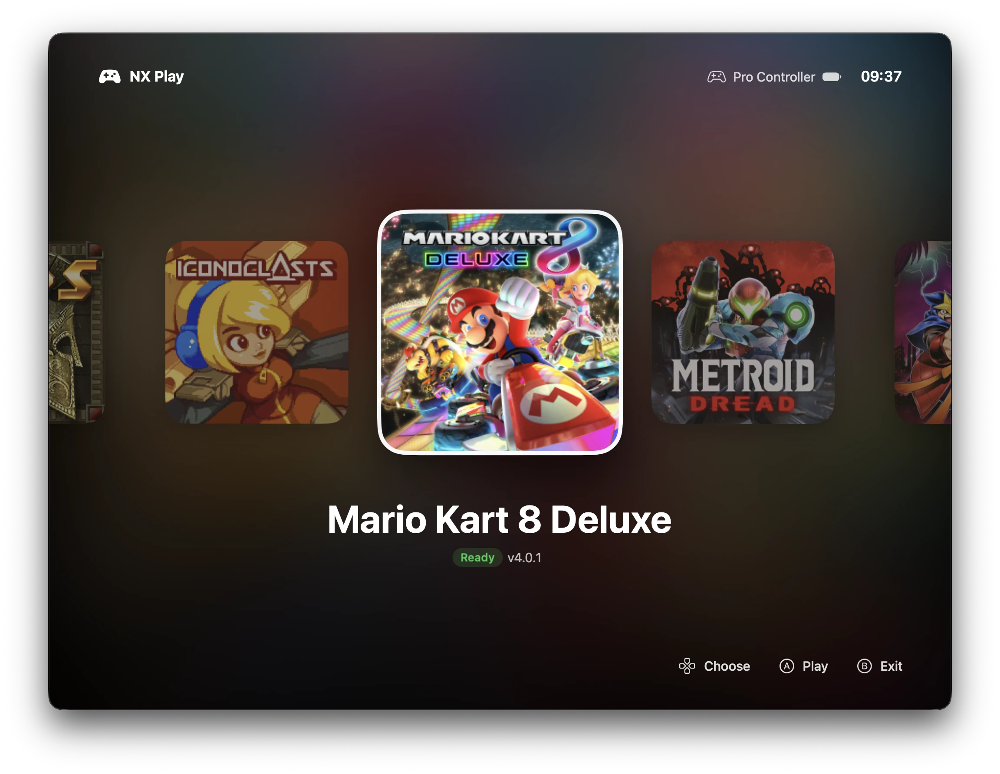
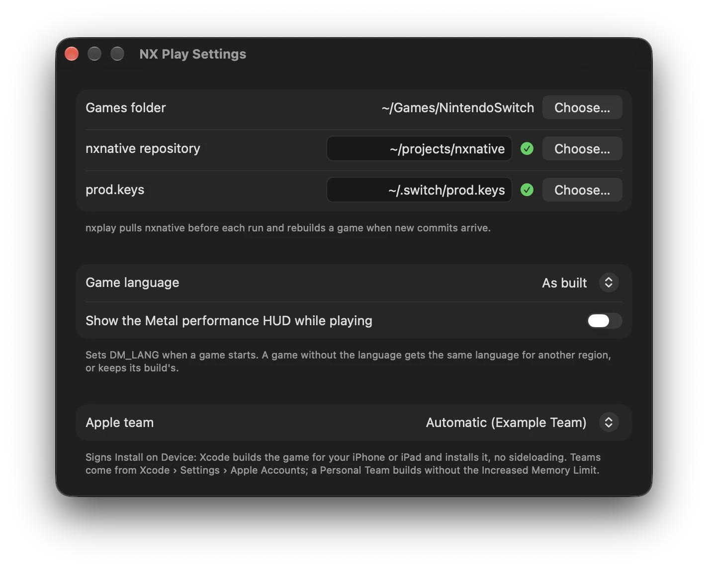

# nx-native-wrapper

**NX Play** is a Mac app (and `nxplay`, the script behind it) that runs Nintendo Switch games natively on a Mac or an iPhone/iPad, through [nxnative](https://github.com/seedds/nxnative). It builds a game once, then starts it straight away the next time.

- A library of your games with their icons: extract them, play them on the Mac, rebuild them.
- Install a game on your iPhone or iPad through Xcode, or build an IPA to sideload.
- Copy saves between the Mac and a device, after seeing which one is newer.
- Pull nxnative's latest fixes before each run, and rebuild only when they change something.

> You need your own games (NSP, NSZ, XCI or XCZ files) and the `prod.keys` of your own Switch. Nothing here downloads games or keys.

## Why

nxnative can already pack one game into a standalone Mac app (`--platform mac-app`), and [nxnative#104](https://github.com/seedds/nxnative/pull/104) brings a native app bundle with preferences and controller mapping. Those are apps for one game each.

NX Play takes the other route: one app for all your games, everything portable and in one place.

- Each game stays in its own folder: the original files, the build, the saves and the IPA side by side. Move the folder, or the whole library, and it keeps working.
- Playing on the Mac, installing on an iPhone or iPad, moving saves and freeing space all happen from the same window.
- Every game follows nxnative as it improves, with no per-game apps to rebuild and replace.



## Requirements

- A Mac with Apple silicon and macOS 15 or later. On an Intel Mac, IPAs and device installs work, but games cannot run on the Mac.
- [Xcode](https://apps.apple.com/app/xcode/id497799835), opened once, with its Metal Toolchain (`bin/setup` downloads it). For iPhone and iPad, its iOS platform too.
- [Homebrew](https://brew.sh).
- For Install on Device: an Apple developer account, signed in under Xcode › Settings › Apple Accounts.

## Setup

```sh
git clone https://github.com/varyform/nx-native-wrapper.git
cd nx-native-wrapper
bin/setup
```

`bin/setup` can be run again at any time. It:

1. checks the Mac and Xcode, and says what to fix; downloads Xcode's Metal Toolchain if it's missing (`xcodebuild -downloadComponent MetalToolchain`), since every build compiles the game's shaders with it;
2. installs the tools with Homebrew (`Brewfile`: uv, xcodegen, zstd, spirv-cross, glslang, the .NET SDK), and the ones in `mise.toml` if you use [mise](https://mise.jdx.dev);
3. installs nxnative's Python packages into `.venv` in this folder with [uv](https://docs.astral.sh/uv/) (`pyproject.toml`, `uv.lock`), leaving your global Python alone;
4. clones nxnative into `./nxnative`;
5. builds NX Play and installs it into `/Applications`.

Put your keys in `~/.switch/prod.keys`, or choose the file in NX Play's Settings.

`bin/setup --check` reports what is missing without changing anything. `bin/setup --no-app` skips building the app.

## NX Play

Open NX Play and choose your games folder, with one subfolder per game:

```
Switch/
├── Metroid Dread/
│   └── Metroid Dread [010093801237C000][v0].nsp
└── Super Mario Bros Wonder/
    └── ….nsz
```

Extracted games show their icons and a **Play** button; the others have **Extract**, and **Extract All** builds them one after another. The panel at the bottom shows the selected game's output. The toolbar switches between the grid and a sortable list (View › as Grid ⌘1 / as List ⌘2).



Right-click a game for more, or use the **Game** menu:

- **Install on Device**: builds the game with Xcode, signed with your team, then installs and starts it on a connected iPhone or iPad. The device must be paired with Xcode and in Developer Mode.
- **Build IPA**: an unsigned IPA in the game folder, for AltStore, Sideloadly and the like.
- **Make Mac App**: a standalone, double-clickable app of the game (nxnative's `--platform mac-app`) in the game folder, for the Dock or Launchpad. It's made of APFS clones of the extracted files, so it takes almost no space on the same volume. It keeps its own save in `~/Library/Application Support/nxnative/<title ID>`, separate from NX Play's.
- **Transfer Saves**: compares the Mac's save with a device's, file by file, and copies one over the other. The replaced save is kept in `<title ID>_build/run/save-backups`.
- **Show in Finder**, **Open Save Folder**, **Open Build Logs**.



**Tools › Free Up Space** lists, per game and with their sizes, what you can delete:

- **Game files:** each game's NSP, NSZ, XCI and XCZ files, plus the NSPs a build converted from NSZ. Only games already built for the Mac qualify, since they keep playing from their build. Without these files a game can't be rebuilt: it keeps its current build when nxnative updates, and Install on Device and Build IPA need the files back. If your games folder holds your only copy, keep a backup.
- **IPAs:** the ones built for sideloading. Build IPA makes them again.
- **Xcode builds:** `<title ID>_build/xcode-derived-data`, which Install on Device keeps to make the next install fast. It's a full copy of the game. Without it the next install works, but compiles and copies everything again.

Pick files one by one, a whole game, or a whole kind. Nothing is selected until you pick it, and deleting needs you to type “yes, I'm sure”. Everything is deleted for good, not moved to the Trash.



Settings has the nxnative folder, the keys file, the game language, the Apple team for device installs, and Apple's Metal performance HUD. **Game Controls** (in the menu bar, and the keyboard button in the toolbar) shows the keyboard controls.

**On the couch:** a game controller drives the library. The D-pad or left stick chooses a game, A plays it, and Menu switches to **Console Mode** (also ⇧⌘F): full screen, with the games ready to play as a carousel of their artwork, the clock, and the controller's button hints. Games started from it open full screen; Settings can make every game start that way. B or Esc goes back.





## Command line

`nxplay` does what the app does, from a terminal:

```sh
./nxplay ~/Games/MetroidDread              # start the game, or build it first if needed
./nxplay --rebuild ~/Games/MetroidDread    # force a rebuild
./nxplay --build-only ~/Games/MetroidDread # build if needed, don't start
./nxplay --ipa ~/Games/MetroidDread        # build the iOS IPA into the game folder, to sideload
./nxplay --mac-app ~/Games/MetroidDread    # pack a standalone Mac app of the game into its folder
./nxplay --device <udid> ~/Games/MetroidDread --team-id <team>   # build with Xcode, install and start on a device
./nxplay --fps ~/Games/MetroidDread        # show the Metal performance HUD
./nxplay --fullscreen ~/Games/MetroidDread # start the game in full screen
./nxplay --lang ja ~/Games/MetroidDread    # play in another language (DM_LANG), no rebuild
./nxplay ~/Games/MetroidDread -l ja        # extra options go to build_ipa_from_nsp.py
```

`xcrun devicectl list devices` lists the device UDIDs.

Each run starts by updating nxnative. New commits are listed, and the game is rebuilt when they change any files. The `./nxnative` clone is only for following upstream: when upstream rewrites its history, nxplay follows it, so keep your own nxnative changes in another clone (`NXNATIVE=/path/to/it`).

The run command is saved in `<game folder>/<title ID>_build/start_mac.sh`. It holds absolute paths, so after you move a game folder (or nxnative), the next run rewrites them to the new location.

Environment variables: `NXNATIVE` (the nxnative checkout; default `./nxnative`, else `../nxnative`), `NX_KEYS` (default `~/.switch/prod.keys`), `NXPLAY_VENV` (default `./.venv`).

## Controls

| Key | Switch button |
| --- | --- |
| W A S D | Left stick |
| Arrow keys | D-pad |
| J / K / U / I | A / B / X / Y |
| Q / E | L / R |
| Z / C | ZL / ZR |
| F / G | Press left stick / press right stick |
| Return / Tab | + / − |
| Space | Shake the controller (while held) |
| Left mouse button | Touchscreen |
| ⌃⌘F | Toggle full screen |
| ⌘Q | Quit the game |

Controllers are detected automatically, with buttons by position (right A, bottom B, top X, left Y). Extra controllers become extra players for local co-op.

## Troubleshooting

- **Start with `bin/setup --check`.** It finds most problems.
- **A build fails:** the panel shows the error, and **Open Build Logs** has each step's full output. Games and the build steps themselves are nxnative's: see its [README](https://github.com/seedds/nxnative#readme) and [known issues](https://github.com/seedds/nxnative#known-issues).
- **No device in Install on Device:** connect it once by cable, trust the Mac, and turn on Developer Mode (Settings › Privacy & Security). **Look Again** refreshes the list.
- **"No Apple developer team":** sign in under Xcode › Settings › Apple Accounts. A free Personal Team works, but without the Increased Memory Limit, so bigger games may be closed by iOS.

## Development

```sh
bin/build        # build/Build/Products/Release/NX Play.app
bin/install      # build and install into /Applications (or: bin/install ~/Applications)
mise run app     # build and open it
mise run test    # NXPlayKit tests (swift test --package-path Packages/NXPlayKit)
```

To work in Xcode, run `xcodegen generate` (or `mise run generate`) and open `NXPlay.xcodeproj`. The code lives in the `Packages/NXPlayKit` Swift package; `project.yml` describes the app.

`Package.swift` in the root exists only so SourceKit-LSP (Zed, VS Code, …) understands the app's sources; build and test with the Xcode project and `Packages/NXPlayKit`.

`bin/screenshots [games folder]` regenerates the screenshots in `docs/`. It needs a folder with at least one extracted game (default `~/Games/Switch`), and it shows the folder's real games, with their names and icons. Everything else is sample data: paths under `~`, an example team, devices and controller, a scripted build log. `bin/screenshots ~/Games/Switch console` redoes just one scene (library, list, console, free-up-space, settings, transfer-saves). The data lives in `Screenshots.swift`, which only Debug builds include. It needs `cwebp` (`brew install webp`) and Screen Recording permission for your terminal.

## License

MIT, see [LICENSE](LICENSE). nxnative has its own license.
